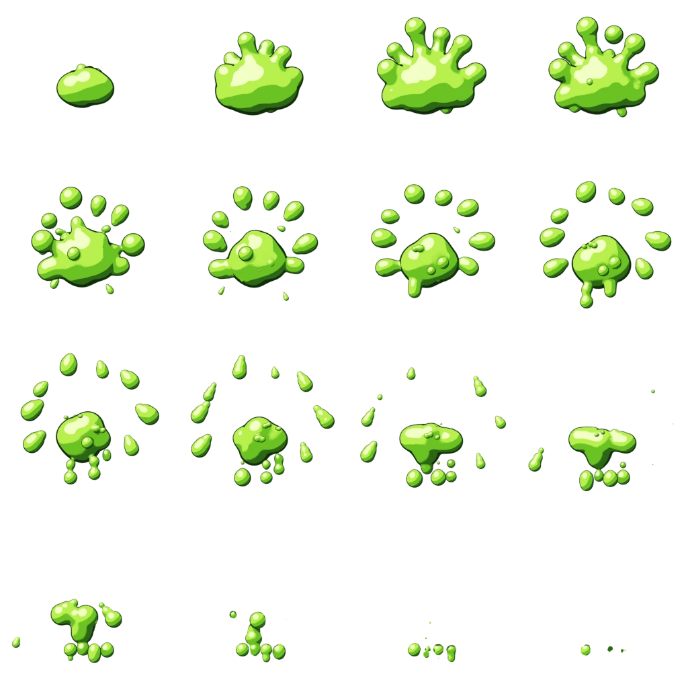
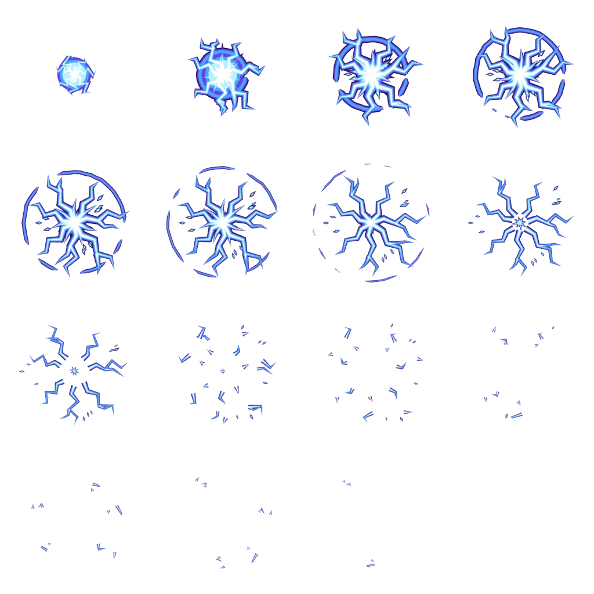

# Blenderben készült effektek

## fire_burst — stilizált tűz-robbanás


| Fájl | Mi ez |
| --- | --- |
| `fire_burst.blend` | A jelenet: 9 zajjal torzított gömb, animált hő/szétmaródás anyag, ortho kamera. Blender 5.3-mal készült. |
| `fire_burst.py` | Ugyanezt a jelenetet a nulláról felépítő és renderelő szkript (headless). |
| `fire_burst_preview.webp` | Színes előnézet a 16 kockáról. |
| `../../src/assets/vfx/fire_burst.webp` | A játék atlasza (4×4 kocka, 256 px): RGB = hő-sáv, A = lefedettség. |

**Megnézni Blenderben:** nyisd meg a `fire_burst.blend`-et, a nézetet állítsd *Rendered* módra,
és játszd le az idővonalat (1–16. kocka). Az anyag (`FireBurst`) node-fájában a bal oldali
értékek irányítják:

- **Heat**: mennyire forró (1 = fehér mag … 0 = füst), kulcskockázva;
- **Erode**: a szétmaródás küszöbe, kulcskockázva;
- **Boil**: a zaj „forrása”;
- **Preview**: 1 = színes előnézet, 0 = a játéknak szánt szürke adat.

A sávhatárok és a színek a két ColorRamp-ben vannak. A játék ugyanezt az öt sávot színezi
a saját tűzpalettájával (`src/game/15-fire-burst.js`, `FIREBURST`).

**Újrarenderelés és csere a játékban** (a repó gyökeréből):

```powershell
& "C:\Program Files\Blender Foundation\Blender 5.3\blender.exe" -b tools/vfx/fire_burst.blend --python tools/vfx/fire_burst.py -- --render --out vfx_out
```

```powershell
node tools/props/to-webp.mjs vfx_out/fire_burst_atlas.png src/assets/vfx/fire_burst.webp 90
```

(A `tools/props` függőségei kellenek hozzá: `npm --prefix tools/props ci`.) Színes előnézethez
a render parancs végére tedd: `--preview`. A jelenetet a nulláról is fel lehet építeni:
`blender -b --factory-startup --python tools/vfx/fire_burst.py -- --save tools/vfx/fire_burst.blend`.

Ha a kockák számát vagy a rácsot változtatod, a `15-fire-burst.js`-ben az effekt `makeFlipbook({...})`
hívásában a `frames` és a `grid` értékét is igazítsd hozzá (alapból 16 kocka, 4×4).

## smoke_puff — rajzfilmes füstpamacs


| Fájl | Mi ez |
| --- | --- |
| `smoke_puff.blend` | Az A változat jelenete: 14 szabálytalan „karfiol”-pamacs + 5 leszakadó kis pamacs, felülről-balról megvilágítva, réssötétítés (ambient occlusion), tus-kontúr, 4 fény-sáv, darabokra szakadás és szétmaródás. |
| `smoke_puff.py` | A két változat (A, B) felépítése és renderelése; a `--render` mindkettőt egy atlaszba rakja. |
| `smoke_puff_preview.webp` | Színes előnézet: felső két sor az A, alsó két sor a B változat (16–16 kocka). |
| `../../src/assets/vfx/smoke_puff.webp` | A játék atlasza (8×4 kocka, 256 px, 2048×1024): RGB = sáv (tus-kontúr / árnyék / közép / fény / csúcsfény), A = lefedettség. |

A játékban a `SMK` füst-pool (`src/game/15-vfx.js`) rajzolja: minden részecske a kora szerinti kockát
mutatja (véletlen változat és tükrözés), az öt sávot a saját színével árnyalja (korom, dér, méreg…), hűvösebb
árnyékkal és melegebb csúcsfénnyel,
a hívások és a mozgás nem változtak. Az anyagban az **Erode** (szétmaródás), a **Boil** (zaj), az **Ink**
(kontúr vastagsága: kisebb = vastagabb) és a **Preview** érték állítható. A `.blend` az A változatot tartalmazza; a `--render` mindkét változatot
mindig újraépíti a szkriptből (a változat alakja a `build_scene` véletlen-magjából jön).

```powershell
& "C:\Program Files\Blender Foundation\Blender 5.3\blender.exe" -b --factory-startup --python tools/vfx/smoke_puff.py -- --render --out vfx_out
```

```powershell
node tools/props/to-webp.mjs vfx_out/smoke_puff_atlas.png src/assets/vfx/smoke_puff.webp 90
```

## Közös szabályok a flipbook-effektekhez (tűz, méreg, por, villám)

- **Adat, nem szín.** Minden atlasz 4×4 kocka, 256 px (1024×1024). Az RGB az **5 sáv** egyikének szürke értéke
  (0.10 / 0.32 / 0.54 / 0.76 / 1.00), az A a lefedettség. A színt a játék adja effektenként a saját 5 színű
  palettájából, így ugyanaz a kemény, rajzfilmes sávozás marad, bármilyen színben.
- **Egy shader mindenre.** A `15-fire-burst.js` `makeFlipbook()` gyára effektenként EGY instanced hálót készít
  (1 rajzolási hívás), kamera felé forduló lapokkal; a paletta, a sávonkénti átlátszóság, a bloom-súly és a
  kockák közti áttűnés uniform, így a négy effekt egyetlen lefordított programon osztozik.
- **Preview érték.** Minden `.blend` anyagában van egy `Preview` érték-node: 1 = színes előnézet (így nyílik meg),
  0 = a játéknak szánt szürke adat. A `--render` mindig adatot renderel, a `--render --preview` a színes változatot.
- **Keretezés.** Az effekt kitölti a kockát, de egyik kocka szélét sem érinti (a `--render` után érdemes
  ellenőrizni, hogy átlátszatlan képpont nem ér a kocka-határra).

## poison_splash — méreg-fröccs



| Fájl | Mi ez |
| --- | --- |
| `poison_splash.blend` | A jelenet: egyetlen „Goo” metaball-család (a `Goo`, `Goo.001`, `Goo.002`… gömbök EGY folyadék-felületté olvadnak össze, így a cseppek valódi nyakkal szakadnak le), szerepek szerint gyűjteményekbe rendezve (`Goo core`, `Goo crown`, `Goo drops`, `Goo drips`, `Goo specks`), plusz három felpattanó buborék (`Bubble0–2`). |
| `poison_splash.py` | A jelenetet a nulláról felépítő és renderelő szkript (headless). |
| `poison_splash_preview.webp` | Színes előnézet a 16 kockáról. |
| `../../src/assets/vfx/poison_splash.webp` | A játék atlasza: RGB = sáv (sötét perem / mélyzöld / közép / világos / nedves csúcsfény), A = lefedettség. |

A becsapódáskor a mag szétlapul, ujjas „korona” csap ki belőle; az ujjak vége megduzzad, elvékonyodik és
könnycseppként leszakad, a cseppek ívben repülnek és leesnek, a felszínen buborékok nőnek és pukkannak, a mag
megereszkedik, csöpögni kezd, darabokra válik, a végén zaj marja szét. Az anyagban (`PoisonSplash`):
**Erode** (szétmaródás), **Boil** (zaj), **Ink** (a sötét perem vastagsága: kisebb = vastagabb; az árnyékos
oldalon magától vastagabb), **Gloss** (a nedves csúcsfény mérete: kisebb = nagyobb), **Preview**.

A játékban a `POISONBURST` rajzolja savzöld palettával (a csúcsfény halványan izzik): méregnyíl becsapódása
(`elementalImpact`) és méreggel megölt troll halála (`elementalDeath`).

## dust_poof — porfelhő


| Fájl | Mi ez |
| --- | --- |
| `dust_poof.blend` | A jelenet: alacsony, széles porgyűrű két sorban (`Dust ring`: nagy pamacsok a földön, kisebbek rajtuk), középen felpúposodó pamacs és leszakadó foszlányok (`Dust puff`), felrúgott, pörgő kavicsok (`Pebbles`). A kamera kicsit felülről néz a talajra. |
| `dust_poof.py` | A jelenetet a nulláról felépítő és renderelő szkript (headless). |
| `dust_poof_preview.webp` | Színes előnézet a 16 kockáról. |
| `../../src/assets/vfx/dust_poof.webp` | A játék atlasza: RGB = sáv (tus-kontúr / árnyék / közép / fény / csúcsfény), A = lefedettség. |

A pamacsok oldalra gördülnek ki a becsapódásból (a két szárny megy a legmesszebb és kunkorodik fel), nőnek,
majd egyenként leszakadnak, közben zaj marja a széleiket; a kavicsok ívben kirepülnek, egyet pattannak és
eltűnnek. A kavicsok sötétebbek: az objektum `tone` tulajdonsága szorozza a fényt (1 = por). Az anyagban
(`DustPoof`): **Erode**, **Boil**, **Ink**, **Preview**. A becsapódási pont a kocka aljától ~17%-ra van:
a játék a kamera felé forduló lapot a méret ~0.34-szeresével megemeli, így a felhő alja a talajon ül.

A játékban a `DUSTPOOF` rajzolja földszínű, holdfényhez visszafogott palettával (nem izzik): troll kibújása
a barlangból (`trollSpawnFx`), földet érés halálkor (`trollDust` a `deathThud`-ból, a földbe süllyedőknél
azonnal), a Troll Király földrengető csapása és a lezuhanó sziklák becsapódása.

## zap_burst — villám-csillag



| Fájl | Mi ez |
| --- | --- |
| `zap_burst.blend` | A jelenet: kockánként külön rajz (stop-motion), a `Zap frames` gyűjteményben `Zap f01`…`Zap f16`; mindegyik csak a saját kockáján látszik, így az idővonal lejátszható. |
| `zap_burst.py` | A rajzokat kockánként felépítő és renderelő szkript (headless). |
| `zap_burst_preview.webp` | Színes előnézet a 16 kockáról. |
| `../../src/assets/vfx/zap_burst.webp` | A játék atlasza: RGB = sáv (sötét perem / ibolya / cián / világoscián / fehér mag), A = lefedettség. |

Éles elektromos becsapódás: tüskés fehér mag-villanás, cikcakkos, elágazó sugarak, amelyek kilőnek, kétkockánként
újra-cikcakkoznak (pattogás), elvékonyodnak, leválnak a magról, darabokra törnek és kialszanak; táguló, szakadozó
gyűrű és kirepülő szikrák. Gyors be / gyors ki: a 3. kockára teljes méretű, a 13. körül már csak foszlányok.
Minden vonás egymásba ágyazott sávokból áll (perem > ibolya > cián > világoscián > fehér mag), mindegyik egy
vékonyabb szalag az előző előtt; a fehér mag csak a sugarak belső részén fut. A vonás sávját a `band`
szín-attribútum hordozza. Az anyagban (`ZapBurst`): **Erode**, **Boil**, **Preview**.

A játékban a `ZAPBURST` rajzolja kemény kockaváltással (nincs áttűnés, attól pattog), és csak a fehér mag és a
világos belső sugarak adnak bloomot: villámnyíl becsapódása (`elementalImpact`), az égi villámcsapás
(`skyStrike`) és a láncvillám minden csomópontja (`chainLightning`, co-opban a szerver lánc-eseménye).

**Újrarenderelés és csere a játékban** (mindhárom ugyanígy, a repó gyökeréből; a `.blend` a `--save`-vel készül):

```powershell
& "C:\Program Files\Blender Foundation\Blender 5.3\blender.exe" -b --factory-startup --python tools/vfx/poison_splash.py -- --render --out vfx_out
node tools/props/to-webp.mjs vfx_out/poison_splash_atlas.png src/assets/vfx/poison_splash.webp 90
& "C:\Program Files\Blender Foundation\Blender 5.3\blender.exe" -b --factory-startup --python tools/vfx/poison_splash.py -- --save tools/vfx/poison_splash.blend
```

A `dust_poof` és a `zap_burst` ugyanígy, a fájlnév cseréjével. Színes előnézethez a render parancs végére tedd:
`--preview` (ez `*_preview.png`-t ír).
