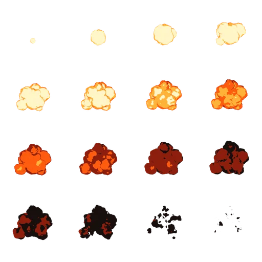
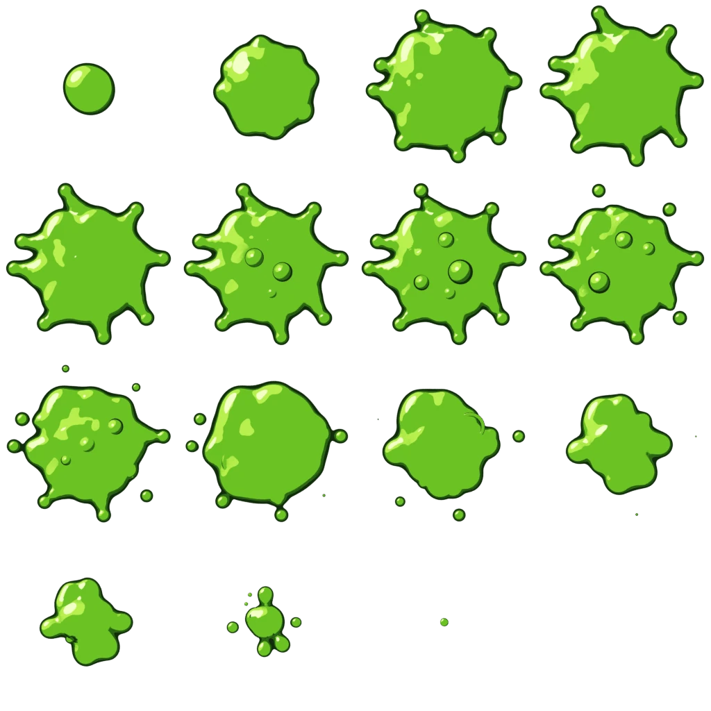
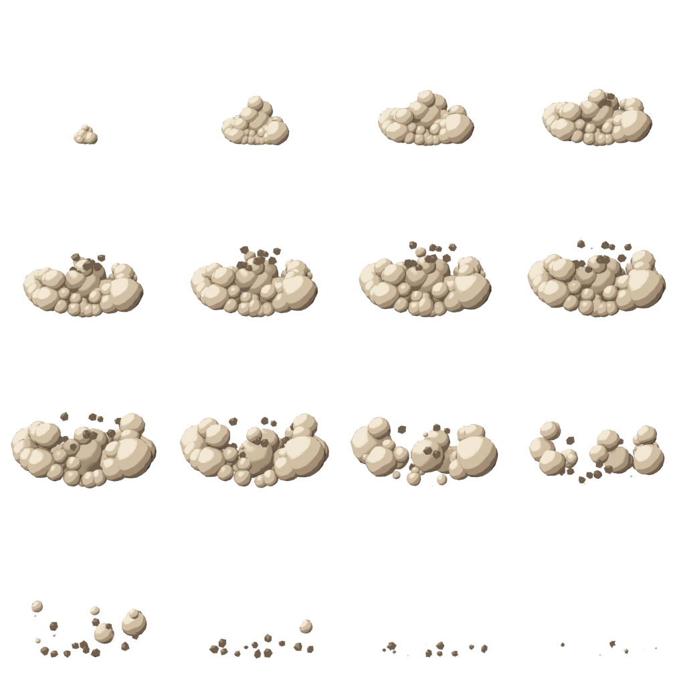
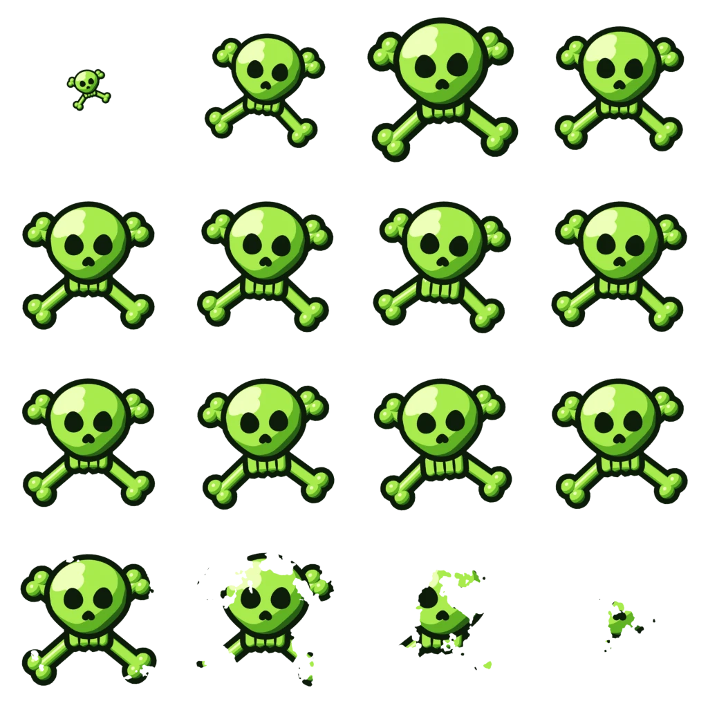
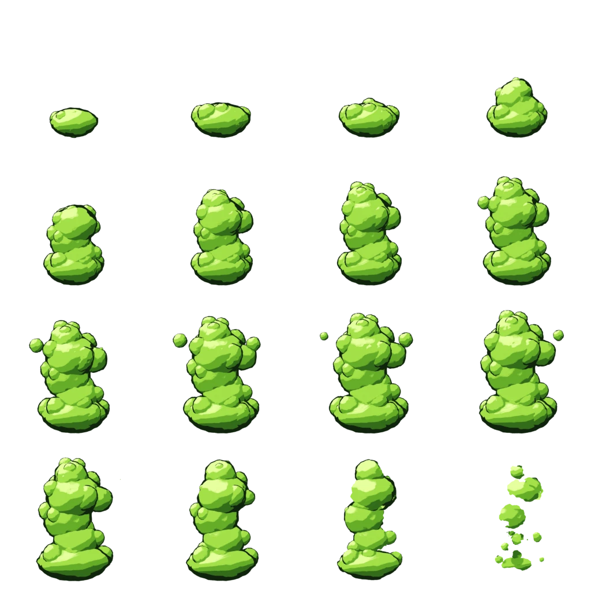
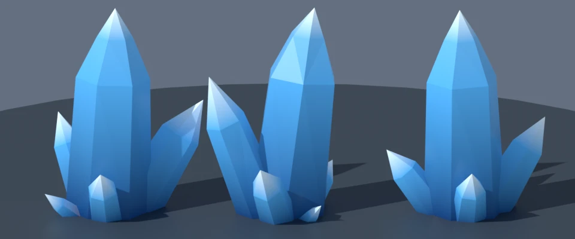
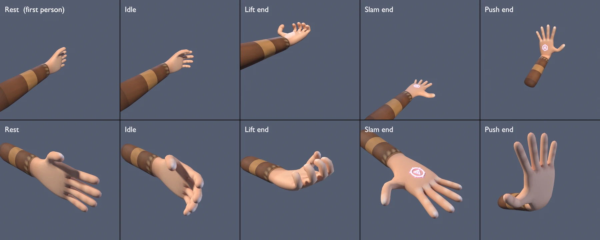

# Blenderben készült effektek

## Renderelés: CPU vagy videókártya

A szkriptek alapból **CPU-n** renderelnek (Cycles), mert ezek a kockák kicsik (256 px, 16–64 minta). Itt a
videókártya elindítása és a jelenet feltöltése tovább tart, mint maga a render. Egy RTX 4050 Laptop GPU-n,
Blender 5.3-mal mérve a teljes futás, CPU kontra OptiX:

| Effekt | CPU | GPU |
| --- | --- | --- |
| dust_poof | 4,1 s | 7,0 s |
| fire_burst | 2,9 s | 6,1 s |
| poison_skull | 4,2 s | 6,4 s |
| left_hand előnézet | 7,2 s | 8,0 s |
| ice_spikes előnézet | 4,7 s | 3,3 s |

A képek gyakorlatilag azonosak (átlagos eltérés 0,000/255). Nagy rendernél (nagy felbontás, sok minta) a
videókártya gyorsabb; ilyenkor a `VFX_DEVICE` környezeti változóval kérhető (`tools/vfx/vfx_device.py`):

```powershell
$env:VFX_DEVICE = 'GPU'
```

`GPU` a leggyorsabb elérhető hátteret választja (OptiX > CUDA > HIP > oneAPI > Metal). `OPTIX`, `CUDA` stb.
pontosan azt kéri. Ha nincs használható kártya, a render CPU-n fut. A választott eszközt a napló első
`[vfx] Cycles device:` sora írja ki.

## fire_burst — stilizált tűz-robbanás



| Fájl | Mi ez |
| --- | --- |
| `fire_burst.blend` | A jelenet: 9 zajjal torzított gömb, animált hő/szétmaródás anyag, ortho kamera. Blender 5.3-mal készült. |
| `fire_burst.py` | Ugyanezt a jelenetet a nulláról felépítő és renderelő szkript (headless). |
| `fire_burst_preview.webp` | Színes előnézet a 16 kockáról. |
| `../../src/assets/vfx/fire_burst.webp` | A játék atlasza (4×4 kocka, 256 px): RGB = hő-sáv, A = lefedettség. |

**Megnézni Blenderben:** nyisd meg a `fire_burst.blend`-et, a nézetet állítsd *Rendered* módra,
és játszd le az idővonalat (1–16. kocka). Az anyag (`FireBurst`) node-fájában a bal oldali
értékek irányítják:

- **Heat**: mennyire forró (1 = fehér mag … 0 = füst), kulcskockázva;
- **Erode**: a szétmaródás küszöbe, kulcskockázva;
- **Boil**: a zaj „forrása”;
- **Preview**: 1 = színes előnézet, 0 = a játéknak szánt szürke adat.

A sávhatárok és a színek a két ColorRamp-ben vannak. A játék ugyanezt az öt sávot színezi
a saját tűzpalettájával (`src/game/15-fire-burst.js`, `FIREBURST`).

**Újrarenderelés és csere a játékban** (a repó gyökeréből):

```powershell
& "C:\Program Files\Blender Foundation\Blender 5.3\blender.exe" -b tools/vfx/fire_burst.blend --python tools/vfx/fire_burst.py -- --render --out vfx_out
```

```powershell
node tools/props/to-webp.mjs vfx_out/fire_burst_atlas.png src/assets/vfx/fire_burst.webp 90
```

(A `tools/props` függőségei kellenek hozzá: `npm --prefix tools/props ci`.) Színes előnézethez
a render parancs végére tedd: `--preview`. A jelenetet a nulláról is fel lehet építeni:
`blender -b --factory-startup --python tools/vfx/fire_burst.py -- --save tools/vfx/fire_burst.blend`.

Ha a kockák számát vagy a rácsot változtatod, a `15-fire-burst.js`-ben az effekt `makeFlipbook({...})`
hívásában a `frames` és a `grid` értékét is igazítsd hozzá (alapból 16 kocka, 4×4).

## smoke_puff — rajzfilmes füstpamacs


| Fájl | Mi ez |
| --- | --- |
| `smoke_puff.blend` | Az A változat jelenete: 14 szabálytalan „karfiol”-pamacs + 5 leszakadó kis pamacs, felülről-balról megvilágítva, réssötétítés (ambient occlusion), tus-kontúr, 4 fény-sáv, darabokra szakadás és szétmaródás. |
| `smoke_puff.py` | A két változat (A, B) felépítése és renderelése; a `--render` mindkettőt egy atlaszba rakja. |
| `smoke_puff_preview.webp` | Színes előnézet: felső két sor az A, alsó két sor a B változat (16–16 kocka). |
| `../../src/assets/vfx/smoke_puff.webp` | A játék atlasza (8×4 kocka, 256 px, 2048×1024): RGB = sáv (tus-kontúr / árnyék / közép / fény / csúcsfény), A = lefedettség. |

A játékban a `SMK` füst-pool (`src/game/15-vfx.js`) rajzolja: minden részecske a kora szerinti kockát
mutatja (véletlen változat és tükrözés), az öt sávot a saját színével árnyalja (korom, dér, méreg…), hűvösebb
árnyékkal és melegebb csúcsfénnyel,
a hívások és a mozgás nem változtak. Az anyagban az **Erode** (szétmaródás), a **Boil** (zaj), az **Ink**
(kontúr vastagsága: kisebb = vastagabb) és a **Preview** érték állítható. A `.blend` az A változatot tartalmazza; a `--render` mindkét változatot
mindig újraépíti a szkriptből (a változat alakja a `build_scene` véletlen-magjából jön).

```powershell
& "C:\Program Files\Blender Foundation\Blender 5.3\blender.exe" -b --factory-startup --python tools/vfx/smoke_puff.py -- --render --out vfx_out
```

```powershell
node tools/props/to-webp.mjs vfx_out/smoke_puff_atlas.png src/assets/vfx/smoke_puff.webp 90
```

## Közös szabályok a flipbook-effektekhez (tűz, méregtócsa, por, villám, méreg-koponya, méregfelhő)

- **Adat, nem szín.** Minden atlasz 4×4 kocka, 256 px (1024×1024). Az RGB az **5 sáv** egyikének szürke értéke
  (0.10 / 0.32 / 0.54 / 0.76 / 1.00), az A a lefedettség. A színt a játék adja effektenként a saját 5 színű
  palettájából, így ugyanaz a kemény, rajzfilmes sávozás marad, bármilyen színben.
- **Egy shader mindenre.** A `15-fire-burst.js` `makeFlipbook()` gyára effektenként EGY instanced hálót készít
  (1 rajzolási hívás), kamera felé forduló lapokkal, vagy talaj-módban (`ground:true`) a földre fektetett lapokkal
  (felülnézetes atlaszhoz, mint a méregtócsa); a paletta, a sávonkénti átlátszóság, a bloom-súly, a kockák közti
  áttűnés és a talaj-mód uniform, így az összes effekt egyetlen lefordított programon osztozik.
- **Preview érték.** Minden `.blend` anyagában van egy `Preview` érték-node: 1 = színes előnézet (így nyílik meg),
  0 = a játéknak szánt szürke adat. A `--render` mindig adatot renderel, a `--render --preview` a színes változatot.
- **Keretezés.** Az effekt kitölti a kockát, de egyik kocka szélét sem érinti (a `--render` után érdemes
  ellenőrizni, hogy átlátszatlan képpont nem ér a kocka-határra).

## poison_pool — méregtócsa (területi effekt, felülnézet)



| Fájl | Mi ez |
| --- | --- |
| `poison_pool.blend` | A jelenet FELÜLRŐL (ortho kamera lefelé néz): lapított metaball-tócsa. A `Goo`, `Goo.001`… gömbök egy felületté olvadnak (`Puddle core`, `Puddle rim`, `Splash fingers`); ugyanezek a gömbök kicsit nagyobban és kicsit lejjebb még kétszer szerepelnek (`Men…` = mélyzöld szegély, `Rim…` = sötét perem; az objektum `rim` tulajdonsága mondja meg az anyagnak), így a tócsa körül egyenletes, rajzfilmes kontúr fut. Plusz felpattanó buborékok (`Bubble0–6`) és a pukkanás gyűrűje (`BubblePop0–6`). |
| `poison_pool.py` | A jelenetet a nulláról felépítő és renderelő szkript (headless). |
| `poison_pool_preview.webp` | Színes előnézet a 16 kockáról. |
| `../../src/assets/vfx/poison_pool.webp` | A játék atlasza: RGB = sáv (sötét perem / mélyzöld / közép / világos / nedves csúcsfény), A = lefedettség. |

Az 1–4. kockán a tócsa gyorsan szétterül a középpontból, szabálytalan, csomós peremmel és rövid, a talajon
kifröccsenő ujjakkal; a 4–10. kockán buborékok nőnek és pukkannak benne, nedves fénnyel; a 10–16. kockán befelé
zsugorodik és zaj marja szét (elpárolog). Az anyagban (`PoisonPool`): **Erode** (párolgás), **Boil** (zaj),
**Ink** (a buborékok sötét gyűrűje: kisebb = vastagabb), **Gloss** (a nedves csúcsfény mérete: kisebb = nagyobb),
**Preview**.

A játékban a `POISONPOOL` rajzolja talaj-módban (`makeFlipbook({ground:true})`: a lap vízszintesen a talajon fekszik,
3 cm-rel fölötte, véletlen Y-forgatással, polygonOffset-tel; csak a csúcsfény izzik halványan). A méretét a valódi
méreg-terület adja (`poisonPool()` a `16-elements.js`-ben): a tócsa ~R sugarú kör (lap = 2.6 × R), a kifröccsenő ujjak
kicsit túlnyúlnak. R = a becsapódási sebzés sugara (`splashR('poison')` × Robbanó Szív): trollon találat 2.6 m, földbe
vagy fába állt nyílnál a fele; méreghalálnál a visszamaradó gázfelhő sugara (2.2 m). Körben néhány alacsony, lassan
felszálló mérgező pamacs (`SMK`) és buborék-pukkanás (`RP`) ad neki térfogatot. (A korábbi, kamera felé forduló
`poison_splash` fröccs kikerült; a fájljai a git-történetben megvannak.)

## dust_poof — porfelhő



| Fájl | Mi ez |
| --- | --- |
| `dust_poof.blend` | A jelenet: alacsony, széles porgyűrű két sorban (`Dust ring`: nagy pamacsok a földön, kisebbek rajtuk), középen felpúposodó pamacs és leszakadó foszlányok (`Dust puff`), felrúgott, pörgő kavicsok (`Pebbles`). A kamera kicsit felülről néz a talajra. |
| `dust_poof.py` | A jelenetet a nulláról felépítő és renderelő szkript (headless). |
| `dust_poof_preview.webp` | Színes előnézet a 16 kockáról. |
| `../../src/assets/vfx/dust_poof.webp` | A játék atlasza: RGB = sáv (tus-kontúr / árnyék / közép / fény / csúcsfény), A = lefedettség. |

A pamacsok oldalra gördülnek ki a becsapódásból (a két szárny megy a legmesszebb és kunkorodik fel), nőnek,
majd egyenként leszakadnak, közben zaj marja a széleiket; a kavicsok ívben kirepülnek, egyet pattannak és
eltűnnek. A kavicsok sötétebbek: az objektum `tone` tulajdonsága szorozza a fényt (1 = por). Az anyagban
(`DustPoof`): **Erode**, **Boil**, **Ink**, **Preview**. A becsapódási pont a kocka aljától ~17%-ra van:
a játék a kamera felé forduló lapot a méret ~0.34-szeresével megemeli, így a felhő alja a talajon ül.

A játékban a `DUSTPOOF` rajzolja világos, lágy meleg-szürke, kis kontrasztú palettával (kissé áttetsző, nem izzik):
troll kibújása a barlangból (`trollSpawnFx`), földet érés halálkor (`trollCollapseDust`: két pamacs a `deathThud`-ból,
a ledőlt test elé tolva, hogy ne takarja el; a földbe süllyedőknél azonnal), a Troll Király földrengető csapása és a
lezuhanó sziklák becsapódása.

## zap_burst — villám-csillag


| Fájl | Mi ez |
| --- | --- |
| `zap_burst.blend` | A jelenet: kockánként külön rajz (stop-motion), a `Zap frames` gyűjteményben `Zap f01`…`Zap f16`; mindegyik csak a saját kockáján látszik, így az idővonal lejátszható. |
| `zap_burst.py` | A rajzokat kockánként felépítő és renderelő szkript (headless). |
| `zap_burst_preview.webp` | Színes előnézet a 16 kockáról. |
| `../../src/assets/vfx/zap_burst.webp` | A játék atlasza: RGB = sáv (sötét perem / ibolya / cián / világoscián / fehér mag), A = lefedettség. |

Éles elektromos becsapódás: tüskés fehér mag-villanás, cikcakkos, elágazó sugarak, amelyek kilőnek, kétkockánként
újra-cikcakkoznak (pattogás), elvékonyodnak, leválnak a magról, darabokra törnek és kialszanak; táguló, szakadozó
gyűrű és kirepülő szikrák. Gyors be / gyors ki: a 3. kockára teljes méretű, a 13. körül már csak foszlányok.
Minden vonás egymásba ágyazott sávokból áll (perem > ibolya > cián > világoscián > fehér mag), mindegyik egy
vékonyabb szalag az előző előtt; a fehér mag csak a sugarak belső részén fut. A vonás sávját a `band`
szín-attribútum hordozza. Az anyagban (`ZapBurst`): **Erode**, **Boil**, **Preview**.

A játékban a `ZAPBURST` rajzolja kemény kockaváltással (nincs áttűnés, attól pattog), és csak a fehér mag és a
világos belső sugarak adnak bloomot: villámnyíl becsapódása (`elementalImpact`), az égi villámcsapás
(`skyStrike`) és a láncvillám minden csomópontja (`chainLightning`, co-opban a szerver lánc-eseménye).

**Újrarenderelés és csere a játékban** (mindhárom ugyanígy, a repó gyökeréből; a `.blend` a `--save`-vel készül):

```powershell
& "C:\Program Files\Blender Foundation\Blender 5.3\blender.exe" -b --factory-startup --python tools/vfx/poison_pool.py -- --render --out vfx_out
node tools/props/to-webp.mjs vfx_out/poison_pool_atlas.png src/assets/vfx/poison_pool.webp 90
& "C:\Program Files\Blender Foundation\Blender 5.3\blender.exe" -b --factory-startup --python tools/vfx/poison_pool.py -- --save tools/vfx/poison_pool.blend
```

A `dust_poof` és a `zap_burst` ugyanígy, a fájlnév cseréjével. Színes előnézethez a render parancs végére tedd:
`--preview` (ez `*_preview.png`-t ír).

## poison_skull — méreg-koponya ikon (koponya + keresztbe tett csontok)



| Fájl | Mi ez |
| --- | --- |
| `poison_skull.blend` | A jelenet SZEMBŐL (ortho kamera): zömök, rajzfilmes koponya (`Skull`; a szemgödrök és az orr lapos tus-matricák), alatta a fogsor (`Teeth`, a fogközök tus-vonalak), mögötte két keresztbe tett csont (`Bone 1`, `Bone 2`). Minden darabnak van tus-burka (`Ink hulls` gyűjtemény, `… ink`): ugyanaz a háló a normálisok mentén kifelé tolva (`Ink width` Displace módosító), amelyből csak a hátlapok látszanak, így minden körvonal egyenletesen vastag tus-vonalat kap, ott is, ahol a koponya a fogsort és a csontokat takarja. Az `Icon` üres objektum viszi a pattanást és a billegést. |
| `poison_skull.py` | A jelenetet a nulláról felépítő és renderelő szkript (headless). |
| `poison_skull_preview.webp` | Színes előnézet a 16 kockáról. |
| `../../src/assets/vfx/poison_skull.webp` | A játék atlasza (4×4 kocka, 256 px): RGB = sáv (tus-kontúr, szemgödrök, orr, fogközök / árnyék / közép / világos / csúcsfény), A = lefedettség. |

Az 1–4. kockán rugózva bepattan (0.30 → 0.86 → 1.11 → 0.97-es méret, egy kis csavarással), az 5–12. kockán áll:
lassan jobbra-balra billeg (±5°, a kép síkjában), közben kétszer vacog (a fogsor lejjebb csúszik, a száj tus-vonala
megvastagszik); a 13–16. kockán képernyő-térbeli zaj marja szét, kívülről befelé, miközben kicsit felfúvódik.
A játéknak szánt tempó ~1,4 mp (~87 ms/kocka), a lapot közben a kód emeli felfelé. Az anyagban (`PoisonSkull`):
**Erode** (szétmaródás), **Boil** (zaj), **Gloss** (a csillanás mérete: kisebb = nagyobb), **Preview**. Az objektumok
`kind` tulajdonsága mondja meg az anyagnak, mi a darab (0 = árnyalt test, 1 = tus-burok, 2 = tus-matrica), a `tone`
sötétít (a csontok kicsit sötétebbek). A tus vastagsága az `… ink` objektumok `Ink width` módosítójának Strength
értéke (0.085). A darabok mélységben rétegezve állnak (elöl a koponya, mögötte a fogsor, leghátul a csontok; ortho
kamerával a mélység nem változtat a méreten), ezért az elöl lévő darab tusa mindig a mögötte lévőre rajzolódik.

Keretezés: az ikon a kocka közepén van (a körvonal befoglaló dobozának közepe = a kocka közepe, a pattanás is e körül
skáláz), álló kockákon ~190×185 px (a kocka ~75%-a), körben legalább ~26 px üres hely; a legnagyobb, túllendülő
(3.) kockán is ≥18 px. A 0. sáv (sötét) a szemgödröket is adja, ezért a palettában legyen sötét és átlátszatlan.

```powershell
& "C:\Program Files\Blender Foundation\Blender 5.3\blender.exe" -b --factory-startup --python tools/vfx/poison_skull.py -- --render --out vfx_out
node tools/props/to-webp.mjs vfx_out/poison_skull_atlas.png src/assets/vfx/poison_skull.webp 90
& "C:\Program Files\Blender Foundation\Blender 5.3\blender.exe" -b --factory-startup --python tools/vfx/poison_skull.py -- --save tools/vfx/poison_skull.blend
```

Színes előnézet: a render parancs végére `--preview`, majd
`node tools/props/to-webp.mjs vfx_out/poison_skull_preview.png tools/vfx/poison_skull_preview.webp 90`.

## poison_cloud — mérgező gázfelhő (oldalnézet, a talajon áll)



| Fájl | Mi ez |
| --- | --- |
| `poison_cloud.blend` | A jelenet OLDALRÓL, kicsit felülről (6°): öt egymásra rakott gomolyag (`Ground pool`, `Stem`, `Stem high`, `Crown`, `Top`), mindegyik egy nagy mag-pamacs (`… core`) és a tetején kisebb dudorok (`… bump N`): dudoros tető, nehéz, simább alj. A `Wisps` gyűjteményben két kis foszlány, amely leszakad a korona oldaláról. |
| `poison_cloud.py` | A jelenetet a nulláról felépítő és renderelő szkript (headless). |
| `poison_cloud_preview.webp` | Színes (zöld) előnézet a 16 kockáról. |
| `../../src/assets/vfx/poison_cloud.webp` | A játék atlasza (4×4 kocka, 256 px): RGB = sáv (tus-kontúr / árnyékos alj / közép / világos tető / kis csúcsfény), A = lefedettség. Szürke adat, a zöldet a játék adja. |

Az 1–5. kockán egy alacsony, talajon ülő pamacsból nő ki: a gomolyagok egymás után buggyannak ki az alattuk lévőből;
a 6–12. kockán felfelé gomolyog: az oszlop megnyúlik, minden pamacs duzzad és gördül, a korona kiszélesedik, a talajon
a gáz szétterül, két foszlány leszakad; a 13–16. kockán elvékonyodik: a pamacsok zsugorodnak, a dudorok egyenként
kihullanak, a zaj a széleknél kezdve marja szét. A játéknak szánt tempó ~1,6 mp (~100 ms/kocka). Nem tűz és nem
robbanás: lassú, nehéz, megülő gáz. Tus-kontúr minden pamacs körvonalán (az átfedéseknél is), az árnyékos oldalon
vastagabban; az alsó oldalakat a réssötétítés (ambient occlusion) is sötétíti. Az anyagban (`PoisonCloud`): **Erode**,
**Boil**, **Ink** (kontúr vastagsága: kisebb = vastagabb), **Preview**.

Keretezés: a talajvonal (a felhő alja) a kocka aljától 8,5%-ra (~22 px) van, az elöl lévő pamacsok ~6 px-szel alá
lógnak (a kamera kicsit felülről néz). A kamera felé forduló lapot a méret ~0.415-szörösével kell megemelni (`lift`),
hogy a felhő alja a talajon üljön. A csúcson ~82% magas és ~70% széles, felül legalább ~24 px, oldalt ~36 px üres hely.

```powershell
& "C:\Program Files\Blender Foundation\Blender 5.3\blender.exe" -b --factory-startup --python tools/vfx/poison_cloud.py -- --render --out vfx_out
node tools/props/to-webp.mjs vfx_out/poison_cloud_atlas.png src/assets/vfx/poison_cloud.webp 90
& "C:\Program Files\Blender Foundation\Blender 5.3\blender.exe" -b --factory-startup --python tools/vfx/poison_cloud.py -- --save tools/vfx/poison_cloud.blend
```

Színes előnézet: a render parancs végére `--preview`, majd
`node tools/props/to-webp.mjs vfx_out/poison_cloud_preview.png tools/vfx/poison_cloud_preview.webp 90`.

## ice_spikes — jégtüske-csokrok (glTF modell, 3 változat)



| Fájl | Mi ez |
| --- | --- |
| `ice_spikes.blend` | A három csokor egymás mellett (`IceSpikeA`, `IceSpikeB`, `IceSpikeC`, az `Ice spikes` gyűjteményben). Az export mindegyiket visszateszi az origóba. |
| `ice_spikes.py` | A hálókat a nulláról felépítő, GLB-be exportáló és az előnézetet renderelő szkript (headless). |
| `ice_spikes_preview.webp` | Színes előnézet (A, B, C balról jobbra). |
| `../../src/assets/vfx/ice_spikes.glb` | A játék modellje: a három háló, mindegyik a saját csomópontjában, identitás-transzformmal. |

Mindegyik csokor egy uralkodó, hatszögű főtüske (enyhén szűkülő hasáb, kétlépcsős, fazettás heggyel) és 2–4 kisebb,
kifelé dőlő mellékkristály, a tövénél egy-két apró szilánkkal; a változatok elrendezése más: **A** egyenes főtüske három
szétálló kristállyal, **B** kicsit dőlő főtüske egy nagy társsal az egyik oldalán, **C** egyenes főtüske négy kristályból
álló koronában. Normalizálás: a főtüske tövének közepe az origó, semmi sincs a talaj alatt (min Y = 0: a mellékkristályok
a talajnál laposra vágva, alul nyitottak), a teljes magasság pontosan 1.0 (+Y), a főtüske tő-sugara ≈ 0.2; kemény
fazetták (szétválasztott normálisok), nincs UV, a transzformok alkalmazva. Háromszögek: A 105, B 119, C 123 (≤ 260).
Szín: csúcsszín (glTF `COLOR_0`, lineáris RGB, VEC4, alfa = 1): minden kristály tövénél mélykék `#0b356c` → középkék
`#4fa8e8` → közel fehér `#e2f6ff` csak a csúcs fazettáin (minden kristály a saját csúcsán fehér). Anyag: egyetlen alap
`IceSpike` (fehér, egyoldalas); a játék a saját jég-anyagát teszi rá.

```powershell
& "C:\Program Files\Blender Foundation\Blender 5.3\blender.exe" -b --factory-startup --python tools/vfx/ice_spikes.py -- --export src/assets/vfx/ice_spikes.glb --preview vfx_out/ice_spikes_preview.png --save tools/vfx/ice_spikes.blend
node tools/props/to-webp.mjs vfx_out/ice_spikes_preview.png tools/vfx/ice_spikes_preview.webp 90
```

Egy szerkesztett `.blend`-ből is lehet exportálni: `blender -b tools/vfx/ice_spikes.blend --python tools/vfx/ice_spikes.py -- --export src/assets/vfx/ice_spikes.glb`.

## left_hand — bal kéz a gravitációs varázslathoz (riggelt, animált glTF modell)



| Fájl | Mi ez |
| --- | --- |
| `left_hand.blend` | A jelenet: a `Hand` (bőr + karvédő) és a `HandRune` (rúna-matrica) háló a `HandRig` csontvázon. Az `Idle` az aktív akció, a `Lift`, a `Slam` és a `Push` álfelhasználóval (fake user) van elmentve, az Action Editorban választhatók. 60 fps-es idővonal. |
| `left_hand.py` | A hálót, a csontvázat, a súlyokat, a csúcsszíneket és a négy animációt a nulláról felépítő, GLB-be exportáló és az előnézetet renderelő szkript (headless). |
| `left_hand_preview.webp` | Színes előnézet. Felső sor: rögzített, belső nézethez (first person) hasonló kamera, amelyen a gyökérmozgás is látszik. Alsó sor: a kezet követő, közeli 3/4-es nézet. Oszlopok: nyugalmi póz, Idle, valamint a Lift, a Slam és a Push végpóza. |
| `../../src/assets/vfx/left_hand.glb` | A játék modellje (~167 KB): skinnelt hálók, csontváz, 4 animáció, csúcsszínek és normálok, textúra nélkül. |

Stilizált, kissé zömök bal kéz rövid alkarcsonkkal: az alkar a csuklótól 0,22 m-re nyúlik hátra, bőr karvédőben.
A csukló és a középső ujj hegye között 0,19 m van. A nyugalmi póz Blenderben: csukló az origóban, ujjak +Y, tenyér +X
(a képernyő közepe felé), hüvelykujj felül (+Z), alkar −Y. A glTF-ben (three.js): ujjak −Z, tenyér +X, hüvelykujj +Y,
alkar +Z. A játék kétszer használja: a kamerán a játékos saját kezeként (a kép bal alsó sarkában), és ×7-es méretben,
áttetsző, izzó „szellemkézként” a célpontnál, ugyanazzal a mozdulattal.

- **Háló:** a `Hand` 2340 háromszög. Kis poligonszámú box-modelling ketrecből készül: 12 csúcsú alkar- és tenyérgyűrűk,
  6 oldalú ujjak, a hüvelykujj pedig a tenyér felső oldalán lévő lyukból nő ki. A ketrecet egyszer felosztja
  (Catmull–Clark), az árnyalás simított. A `HandRune` 62 háromszög: lapos jel (gyűrű, befelé mutató háromszög, középső
  rombusz, hat tüske) a kézfejen, 1,6 mm-rel a bőr fölött. 100%-ban a `Palm` csonthoz kötött, minden kockán a bőr fölött
  marad. Saját anyaga van (`HandRune`), csúcsszíne nincs, a játék adjon neki emisszív anyagot.
- **Csúcsszín:** glTF `COLOR_0`, sarkonként (face corner) tárolva, lineáris RGB, VEC4 (alfa = 1), UNSIGNED_SHORT,
  normalizált. A three.js-ben `itemSize` 4, `normalized: true`, fehér anyaggal kell használni (`vertexColors: true`).
  - Bőr: meleg alapszín, világosabb tenyér és belső ujjoldal, világosabb ujjperc-tetők, rózsaszínesebb ujjbegyek, világos
    körmök. A sötétebb hajlatok beégetett, rövid (1,1 cm-es) réssötétítésből jönnek: az ujjak között, a hüvelykujj tövénél
    és a mandzsetta pereme alatt.
  - Karvédő: barna bőr, világosabb pántsáv, sötétebb mandzsetta „fonott” öltéssorral, és egy világosabb, felhajtott perem.
  - A `Hand` anyag fehér, az érdesség 0,75.
- **Csontváz:** `Wrist` (gyökér, az origóban) → `Palm` → `Thumb1..3`, `Index1..3`, `Middle1..3`, `Ring1..3`,
  `Pinky1..3`. A súlyokat a szkript a felosztott hálón számolja: ízületenként sima átmenet, csúcsonként legfeljebb 4 csont.
- **Animációk:** külön glTF animációk, 60 fps-sel mintavételezve. A 0,55 és a 0,45 mp 30 fps-nél nem egész számú kocka,
  a glTF exportáló pedig csak egész kockákat mintavételez, ezért 60 fps. Mindhárom mozdulat az `Idle` első kockájáról
  indul, és a végpózban marad (a játékban `LoopOnce` és `clampWhenFinished` kell).
  - `Idle`, 2,0 mp, hurkolható: lazán behajlított ujjak, lassú, „lélegző” lebegés (±3,5 mm).
  - `Lift`, 0,55 mp: kis lemerülés és befelé fordulás (előkészítés), majd a tenyér felfelé fordul, az ujjak erős karomba
    hajlanak, és a kéz 0,12 m-t emelkedik (0,25 mp-nél 0,135 m-es túllendüléssel). A végén a felemelt karomban marad.
  - `Slam`, 0,45 mp: felhúzás (+0,06 m, a csukló hátrahajlik), majd lecsapás tenyérrel lefelé, szétterpesztett, lapos
    ujjakkal. A becsapódás 0,265 mp-nél van (−0,17 m), utána kis visszapattanás, a vége −0,15 m.
  - `Push`, 0,45 mp: hátrahúzás (−0,045 m), majd a csukló hátrahajlik (tenyér előre, ujjak felfelé, szétterpesztve), és
    a kéz 0,18 m-t lök előre (0,235 mp-nél 0,205 m-es túllendüléssel).
- **Gyökérmozgás:** a `Wrist` csont eltolásán van, a glTF-ben a `Wrist` csomópont `translation` sávjában. A sáv a
  `HandRig` csomópont (Y-felfelé álló) terében értendő. Végértékek: Lift (0; +0,12; 0), Slam (0; −0,15; 0), Push
  (0; +0,012; −0,18).
  - A `Wrist` csomópont nyugalmi forgatása −90° az X tengely körül (ebben van a Z-fel → Y-fel átváltás). Ha a játék
    kódból forgatja ezt a csontot, ezzel számolni kell.
  - A többi csontnak csak a forgatása van animálva, az állandó eltolás- és skálasávok nincsenek exportálva.
- **Rúna láthatósága:** nyugalmi és Idle pózban a kézfej, és vele a rúna, a képernyő közepétől elfelé néz. A Slam és a
  Push végén a kamera felé fordul.

```powershell
& "C:\Program Files\Blender Foundation\Blender 5.3\blender.exe" -b --factory-startup --python tools/vfx/left_hand.py -- --export src/assets/vfx/left_hand.glb --preview vfx_out/left_hand_preview.png --save tools/vfx/left_hand.blend
node tools/props/to-webp.mjs vfx_out/left_hand_preview.png tools/vfx/left_hand_preview.webp 90
```

Egy szerkesztett `.blend`-ből is lehet exportálni: `blender -b tools/vfx/left_hand.blend --python tools/vfx/left_hand.py -- --export src/assets/vfx/left_hand.glb`.
