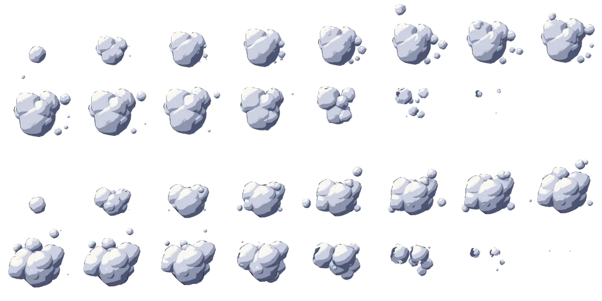

# Blenderben készült effektek

## fire_burst — stilizált tűz-robbanás


| Fájl | Mi ez |
| --- | --- |
| `fire_burst.blend` | A jelenet: 9 zajjal torzított gömb, animált hő/szétmaródás anyag, ortho kamera. Blender 5.3-mal készült. |
| `fire_burst.py` | Ugyanezt a jelenetet a nulláról felépítő és renderelő szkript (headless). |
| `fire_burst_preview.webp` | Színes előnézet a 16 kockáról. |
| `../../src/assets/vfx/fire_burst.webp` | A játék atlasza (4×4 kocka, 256 px): RGB = hő-sáv, A = lefedettség. |

**Megnézni Blenderben:** nyisd meg a `fire_burst.blend`-et, a nézetet állítsd *Rendered* módra,
és játszd le az idővonalat (1–16. kocka). Az anyag (`FireBurst`) node-fájában a bal oldali
értékek irányítják:

- **Heat**: mennyire forró (1 = fehér mag … 0 = füst), kulcskockázva;
- **Erode**: a szétmaródás küszöbe, kulcskockázva;
- **Boil**: a zaj „forrása”;
- **Preview**: 1 = színes előnézet, 0 = a játéknak szánt szürke adat.

A sávhatárok és a színek a két ColorRamp-ben vannak. A játék ugyanezt az öt sávot színezi
a saját tűzpalettájával (`src/game/15-fire-burst.js`).

**Újrarenderelés és csere a játékban** (a repó gyökeréből):

```powershell
& "C:\Program Files\Blender Foundation\Blender 5.3\blender.exe" -b tools/vfx/fire_burst.blend --python tools/vfx/fire_burst.py -- --render --out vfx_out
```

```powershell
node tools/props/to-webp.mjs vfx_out/fire_burst_atlas.png src/assets/vfx/fire_burst.webp 90
```

(A `tools/props` függőségei kellenek hozzá: `npm --prefix tools/props ci`.) Színes előnézethez
a render parancs végére tedd: `--preview`. A jelenetet a nulláról is fel lehet építeni:
`blender -b --factory-startup --python tools/vfx/fire_burst.py -- --save tools/vfx/fire_burst.blend`.

Ha a kockák számát vagy a rácsot változtatod, a `15-fire-burst.js`-ben a `FRAMES` értékét és a
`cell()` függvény 4×4-es osztását is igazítsd hozzá.

## smoke_puff — rajzfilmes füstpamacs



| Fájl | Mi ez |
| --- | --- |
| `smoke_puff.blend` | Az A változat jelenete: 14 szabálytalan „karfiol”-pamacs + 5 leszakadó kis pamacs, felülről-balról megvilágítva, réssötétítés (ambient occlusion), tus-kontúr, 4 fény-sáv, darabokra szakadás és szétmaródás. |
| `smoke_puff.py` | A két változat (A, B) felépítése és renderelése; a `--render` mindkettőt egy atlaszba rakja. |
| `smoke_puff_preview.webp` | Színes előnézet: felső két sor az A, alsó két sor a B változat (16–16 kocka). |
| `../../src/assets/vfx/smoke_puff.webp` | A játék atlasza (8×4 kocka, 256 px, 2048×1024): RGB = sáv (tus-kontúr / árnyék / közép / fény / csúcsfény), A = lefedettség. |

A játékban a `SMK` füst-pool (`src/game/15-vfx.js`) rajzolja: minden részecske a kora szerinti kockát
mutatja (véletlen változat és tükrözés), az öt sávot a saját színével árnyalja (korom, dér, méreg…), hűvösebb
árnyékkal és melegebb csúcsfénnyel,
a hívások és a mozgás nem változtak. Az anyagban az **Erode** (szétmaródás), a **Boil** (zaj), az **Ink**
(kontúr vastagsága: kisebb = vastagabb) és a **Preview** érték állítható. A `.blend` az A változatot tartalmazza; a `--render` mindkét változatot
mindig újraépíti a szkriptből (a változat alakja a `build_scene` véletlen-magjából jön).

```powershell
& "C:\Program Files\Blender Foundation\Blender 5.3\blender.exe" -b --factory-startup --python tools/vfx/smoke_puff.py -- --render --out vfx_out
```

```powershell
node tools/props/to-webp.mjs vfx_out/smoke_puff_atlas.png src/assets/vfx/smoke_puff.webp 90
```
